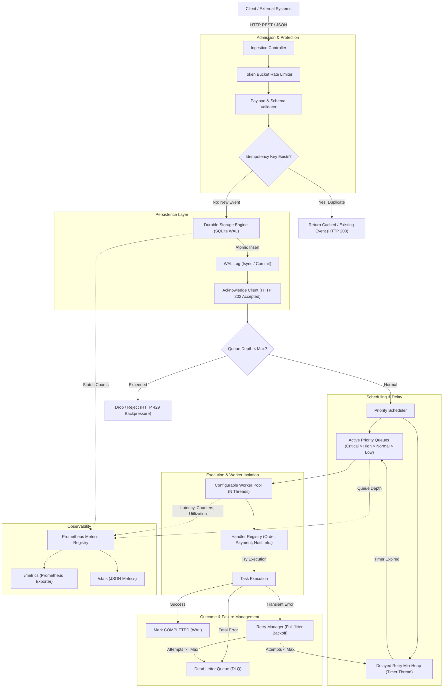

# RelayForge Architecture Specification

## 1. Executive Summary

**RelayForge** is an industrial-grade, fault-tolerant event processing engine engineered in modern C++20. It is purposefully designed to solve five ubiquitous failure modes in distributed event architectures:
1. **Duplicate Request Storms**: Mitigated by strict transactional idempotency key indexing.
2. **Worker Thread Failures**: Contained by an isolated worker thread shield preventing uncaught exceptions from destabilizing the engine.
3. **Application & Host Crashes**: Prevented from causing event loss by persisting state to SQLite Write-Ahead Logging (WAL) prior to network acknowledgment.
4. **Traffic Surges & Upstream Saturation**: Controlled via Token Bucket rate limiting and bounded priority queue backpressure.
5. **Thundering Herd Retries**: Prevented using Exponential Backoff with randomized Full Jitter.

---

## 2. High-Level Architecture

---

## 3. Core Subsystems

### 3.1 Durable Storage Engine (`relayforge::SqliteStorage`)
- **Write-Ahead Logging (WAL)**: SQLite configured with `PRAGMA journal_mode = WAL` and `PRAGMA synchronous = NORMAL`. Readers do not block writers, and writers do not block readers.
- **Append-Oriented Ingestion**: Events are persisted to disk in the `events` table before HTTP 202 is returned to the client.
- **Audit Trail**: Every status transition (`INGESTED`, `IN_FLIGHT`, `COMPLETED`, `FAILED_RETRYABLE`, `DEAD_LETTER`, `REPLAY_QUEUED`) is recorded in the `event_audit_log` table with timestamps, attempt counts, execution duration, and error messages.
- **Idempotency Index**: Unique index on `idempotency_key` guarantees that concurrent or repeated submissions are caught transactionally without duplicates entering the active queue.

### 3.2 Dynamic Backpressure & Admission Control
- **Token Bucket Rate Limiter**: High-resolution, thread-safe token bucket allows burst capacity up to configured limits while constraining steady-state ingest to target EPS.
- **Queue Saturation Shield**: The scheduler enforces a hard limit (`max_queue_depth`). When memory queues reach capacity, the engine immediately responds with `HTTP 429 Backpressure Exceeded`, protecting the process from out-of-memory crashes.

### 3.3 Priority Scheduler & Delayed Retry Heap
- **Multi-Level Priority Queues**: Strict priority ordering (`CRITICAL = 0`, `HIGH = 1`, `NORMAL = 2`, `LOW = 3`). Critical infrastructure and high-value financial events bypass normal background tasks.
- **Delayed Retry Min-Heap**: Events scheduled for future execution (due to backoff delay) are kept in a min-heap indexed by `scheduled_at`. A background timer thread sleeps on a condition variable until the nearest timestamp, unblocking and moving ready tasks into the active queue with zero CPU spinning.

### 3.4 Worker Pool & Exception Isolation Shield
- **Thread Isolation**: Configurable worker pool using C++20 threading primitives.
- **Exception Containment**: Handlers are executed within nested exception shields.
  - Standard `std::exception` and polymorphic derived errors are logged, measured, and routed to the `RetryManager`.
  - Uncaught native exceptions (`...`) are trapped without taking down the worker thread or process.
- **Utilization Tracking**: Atomic tracking of active worker threads enables accurate measurement of instantaneous and rolling worker utilization.

### 3.5 Retry Manager & Dead Letter Queue (DLQ)
- **Full Jitter Exponential Backoff**:
  $$\text{Interval} = \min(\text{max\_interval}, \text{initial\_interval} \times \text{factor}^{\text{attempt}-1})$$
  $$\text{Sleep} = \text{UniformRandom}(0, \text{Interval})$$
  Randomized jitter decorrelates retry requests, preventing harmonic retry stampedes against recovering downstream services.
- **DLQ Replay Mechanism**: Exhausted or fatal events enter `DEAD_LETTER` state. Operators can inspect failed payloads, review historical audit trails, and trigger manual replay with reset retry budgets via `POST /dlq/{id}/replay`.

### 3.6 Crash Recovery Manager
- When the engine starts up, the `RecoveryManager` scans for any unsettled records:
  - Events left in `IN_FLIGHT` from an abrupt termination (e.g., `SIGKILL`, power failure) are identified.
  - Attempt counts are incremented. If an event repeatedly causes process termination, it is quarantined to `DEAD_LETTER` as a poison pill.
  - Recoverable events are placed back into the scheduler.

### 3.7 Live Monitoring Dashboard & Simulation UI
- **Dual-Mode Telemetry Frontend**:
  - Built with modern Tailwind CSS, Chart.js, and Lucide icons with zero external framework build dependencies.
  - Serves directly from the native C++ server (`/dashboard`), FastAPI gateway (`/dashboard`), GitHub Pages (`https://thakursahab9910.github.io/RelayForge/`), or Vercel (`vercel.json`).
  - **Live Production Mode**: Connects directly to `relayforge_server` REST endpoints (`/stats`, `/metrics`, `/events`, `/dlq`) using CORS pre-routing headers.
  - **Interactive In-Browser Simulation**: When disconnected from the local engine, the dashboard seamlessly activates a real-time virtual simulation mimicking priority scheduling, Full Jitter backoff, and DLQ quarantine.
  - **Administrative Controls**: Includes a 1-click Dead Letter Queue inspector and re-enqueuing mechanism via `POST /dlq/:id/replay`, custom JSON payload dispatcher, and high-density burst traffic generator.
