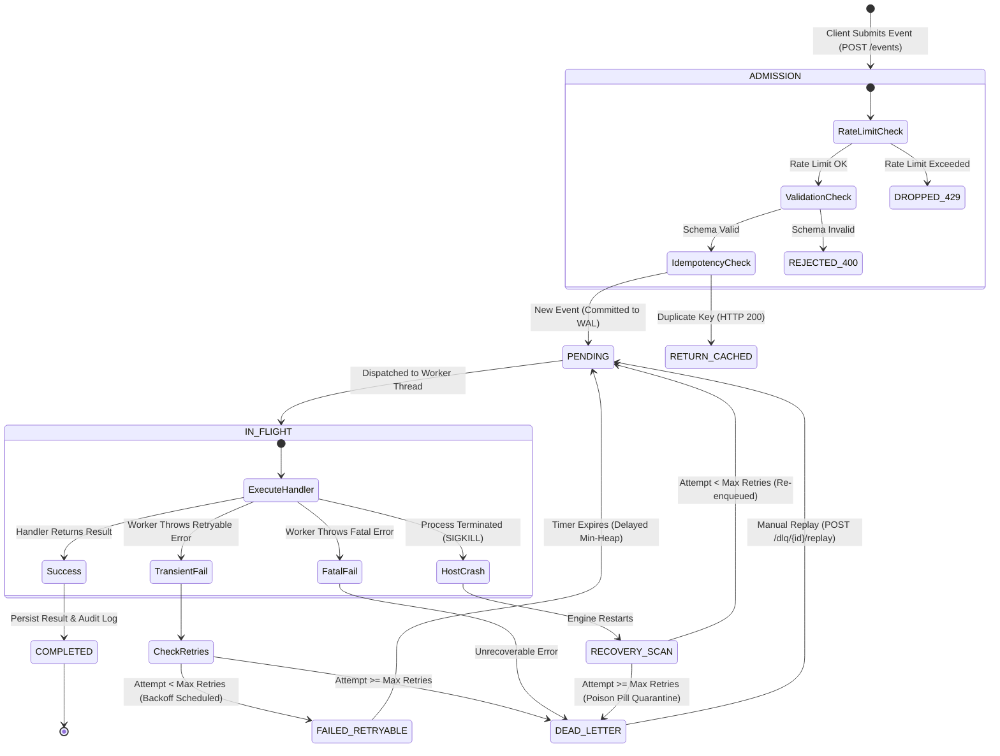

# RelayForge Event Lifecycle & State Machine

## 1. Event State Machine

Every event ingested into RelayForge adheres to a deterministic, crash-safe state machine. All state transitions are committed to disk via SQLite Write-Ahead Logging (WAL) and recorded in the audit trail.



---

## 2. Event States Defined

| State | Storage Location | Description |
|---|---|---|
| `PENDING` | SQLite & In-Memory Priority Queue | Event is durably persisted and queued for execution. Scheduled for immediate or future dispatch. |
| `IN_FLIGHT` | SQLite & Worker Thread | Worker thread has claimed the event and is actively executing its domain handler. |
| `COMPLETED` | SQLite | Event successfully executed. Result payload stored in `execution_result`. Audit log records total duration. |
| `FAILED_RETRYABLE` | SQLite & Delayed Retry Heap | Execution failed with a transient error. Next attempt time calculated with Full Jitter and stored in `scheduled_at`. |
| `DEAD_LETTER` | SQLite | Retries exhausted or fatal exception encountered. Event quarantined awaiting inspection or manual operator replay. |

---

## 3. Idempotency Flow

To prevent duplicate execution in distributed environments where networks retry requests:
1. The client supplies an `idempotency_key` (e.g. `order-xyz-1001`).
2. An atomic check-and-insert transaction executes against the `events` table with a `UNIQUE` constraint on `idempotency_key`.
3. If an event with this key already exists:
   - The engine does **not** re-enqueue the event.
   - The engine fetches the existing record and returns `HTTP 200 OK` with the existing status and cached result payload.
4. If the key is new:
   - The event is persisted with status `PENDING`.
   - The engine returns `HTTP 202 Accepted` with the generated `event_id`.

---

## 4. Exponential Backoff with Full Jitter

When a worker encounters a transient failure, `RetryManager` calculates the delay until the next attempt:

```
// Step 1: Standard exponential backoff with cap
exponential_delay = min(max_interval_ms, initial_interval_ms * (backoff_factor ^ (attempt - 1)))

// Step 2: Full Jitter decorrelation
scheduled_delay_ms = uniform_random(0, exponential_delay)
```

### Why Full Jitter?
Standard exponential backoff without jitter results in synchronized retry waves ("thundering herds") hitting upstream or downstream resources simultaneously. Full Jitter distributes retry attempts uniformly between $[0, \text{exponential\_delay}]$, achieving maximum spread and minimal contention.

---

## 5. Crash Recovery & Poison Pill Quarantine

When RelayForge reboots after a crash or host termination:
1. `RecoveryManager::recover_unsettled_events()` scans the WAL database for records with status `IN_FLIGHT`, `PENDING`, or `FAILED_RETRYABLE`.
2. Any event in `IN_FLIGHT` indicates the prior engine process died mid-execution:
   - Attempt count is incremented: `attempt_count += 1`.
   - If `attempt_count > max_retries`: The event is considered a "poison pill" (e.g., a corrupted payload triggering an OS abort or segfault) and moved directly to `DEAD_LETTER`.
   - Otherwise: The event status is reset to `PENDING` and pushed into the `PriorityScheduler`.
3. Any event in `FAILED_RETRYABLE` is placed in the delayed retry heap according to its original `scheduled_at` timestamp.
4. Normal worker execution resumes seamlessly with zero event loss.
